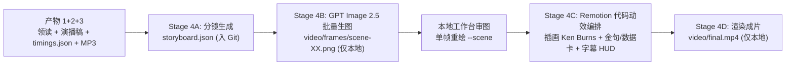

# 产物 4：自动化播客视频设计方案（GPT Image 2.5 + Remotion）

> 本方案以「**AI 无字编辑插画 + Remotion 代码化动效排版**」构建从产物 1~3 到成品播客视频的自动化管线，实现时间轴自动对齐、增量生图与单帧局部重绘。

---

## 1. 核心架构：数据驱动的 4 阶段流水线

产物 3 已产出与音频毫秒对齐的 `artifacts/<slug>/podcast/<provider>.timings.json`（每段台词精确的 `startSec`、`endSec` 与 `hostId`），视频时间轴由代码直接驱动生成：

---

## 2. 视觉风格圣经与图文分工

### 2.1 统一视觉风格（`pipelines/video/styleBible.ts`）

采用**潦草手绘蜡笔与马克笔编辑插画风格（Loose Sketchy Crayon & Marker Editorial Illustration）**，呈现报刊评论插画与思想专栏速写的现场感：

- **笔触与线条**：快速、松弛、带有潦草速写感的黑色手绘轮廓线，粗细随手势自然起伏，保留急促排线、起落重叠与断续笔触。
- **色彩与纸感**：纯白画纸底色，以红、黄、钴蓝、橙、紫、绿等明快直接的编辑色块进行蜡笔扫涂与马克笔平涂，保留粗粝颗粒、纸纹飞白与随性越界色块。
- **造型语言**：精炼传神的成人报刊漫画与讽刺速写造型，以利落剪影、克制而犀利的姿态神态、几笔到位的物件概括传递观点与冷幽默。
- **画面构图**：松弛透气的编辑插画版式，留白充足、焦点明确，以少量手绘箭头或极简图形记号串联逻辑，画面本身保持无字状态。

### 2.2 图文分工与服务配置

- **无字插画由 GPT Image 2.5 生成**：服务端点与密钥通过本地 `.env` 管理（`IMAGE_API_BASE_URL`、`IMAGE_API_KEY`、`IMAGE_MODEL=gpt-image-2.5`），由 [pipelines/video/imageClient.ts](../pipelines/video/imageClient.ts) 封装异步提交（`POST /v1/images/generations` + `Idempotency-Key`）、状态轮询（`GET /api/image-tasks?ids={taskid}`）与参考图生图（`POST /v1/images/edits`），通过 [pipelines/video/generate-image.ts](../pipelines/video/generate-image.ts)（`npm run video:image`）统一调度。
- **文字与数据由 Remotion 代码精确渲染**：全部中文标题、Key20 原典金句、对比数据卡、幕间标题与双人字幕均由 React + Tailwind 渲染，确保排版锐利与零错字。
- **节奏密度与增量缓存**：30 分钟播客按逻辑意群聚合为 **18–26 个视觉场景**（约 14–18 帧主视觉插画，穿插纯代码幕间卡、金句卡与数据对比卡）。每场记录 `promptHash = sha256(styledPrompt).slice(0, 12)`，默认跳过哈希未变帧，支持 `--scene <sceneId> --force` 单帧重绘。

---

## 3. 数据契约（`pipelines/video/types.ts`）

核心数据结构定义于 [pipelines/video/types.ts](../pipelines/video/types.ts)：

- **`VideoStoryboard`**：记录 `bookSlug`、`audioProvider`（默认 `fish`）、`aspectRatio`（`16:9` 1920×1080 长视频或 `9:16` 1080×1920 精华切片）、`fps: 30`、`styleBible` 与 `scenes[]`。
- **5 种标准 Remotion 场景布局模板（`VideoSceneLayout`）**：
  1. `act-title-card`：幕间转场标题卡，对齐 `[pause:long]` 停顿，呈现幕号、标题与核心问题。
  2. `editorial-illustration`：主视觉插画卡，叠加缓慢 `Ken Burns` 运动、微纸纹与章节锚标。
  3. `quote-spotlight`：Key20 原典金句高光卡，对齐降速引文段落，支持中英对照与出处角标。
  4. `data-contrast`：实证数据与概念对比卡，以代码绘制高对比度数字或双栏结构。
  5. `closing-card`：片尾收束卡，展示书名、原著版本与阅读线索。
- **常驻播客 HUD 层**：底部联动 `timings.json` 显示发言人高亮（林舟 / 苏晴）与音频波形、7 幕进度条及精准断句双行字幕。

---

## 4. 独立依赖与落盘规范

- **Remotion 子包隔离**：视频渲染工程独立置于 `pipelines/video/remotion/`，与公开领读站及本地工作台依赖解耦。
- **产物落盘与 Git 策略**：
  - `artifacts/<slug>/video/storyboard.json`：轻量化分镜与提示词，同步入 Git。
  - `artifacts/<slug>/video/frames/*.png` 与 `final.mp4`：大体积媒体文件，经 `.gitignore` 仅本地保留。
- **工作台联动**：[VideoSlotPreview.tsx](../apps/workbench/src/components/VideoSlotPreview.tsx) 自动探测 `storyboard.json`、`frames/` 与 `final.mp4`，落盘后刷新本地工作台（`npm run workbench`）即可按场景展开审图与预览成片。
