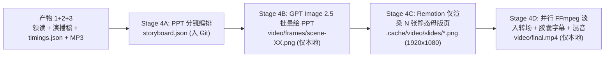

# 产物 4：自动化播客视频设计方案（GPT Image 2.5 手绘 PPT + 零冗余帧极速合成引擎）

> 本方案以「**AI 手绘信息图 PPT + Keynote 级封面/收束排版 + 零冗余帧并行合成引擎**」构建从产物 1~3 到成品播客视频的高效管线，兼顾杂志画廊级视觉美感、毫秒级字幕同步与分钟级全高清渲染速度。

---

## 1. 核心架构：零冗余帧 4 阶段流水线

产物 3 已产出与音频毫秒对齐的 `artifacts/<slug>/podcast/<provider>.timings.json`（每段台词精确的 `startSec`、`endSec`），视频时间轴由数据直接驱动：

### 零冗余帧效率核心
传统逐帧浏览器截图渲染 30 分钟视频需要输出 3–5 万张浏览器帧，而 PPT 视觉叙事的画面状态仅在「翻页」与「字幕切换」时变化：
1. **浏览器仅出母版静态页**：Remotion `renderStill` 仅为每个分镜渲染 **1 张 1920×1080 无字幕母版 PNG**（整片仅 25–30 张，耗时约 15 秒，单页内容哈希缓存）。
2. **原生 FFmpeg 并行合成**：多核并行按页生成精确帧数片段，页间自动执行 `0.35s` 平滑淡入淡出（`xfade=transition=fade`），通过 `libass` 加载本地缓存的 `Noto Sans CJK SC Medium` 字体烧录圆角半透暗墨胶囊字幕，使用 `-tune stillimage` 压缩静止帧，全片 1080p 高清渲染耗时从小时级压缩至分钟级。

---

## 2. 视觉风格圣经与 PPT 画面设计

### 2.1 统一手绘信息图 PPT 风格（`pipelines/video/styleBible.ts`）

采用**潦草手绘蜡笔与马克笔编辑信息图 PPT 风格（Loose Sketchy Crayon & Marker Editorial Infographic Slide）**，整张图本身即是一页图文并茂的高质量知识演示 PPT：

- **笔触与线条**：快速、松弛、带有潦草速写感的黑色手绘轮廓线，粗细随手势自然起伏，保留急促排线、起落重叠与断续笔触。
- **色彩与纸感**：纯白画纸底色（`#FFFFFF`），以朱红、芥末黄、钴蓝、焦橙、紫、森绿等明快直接的编辑色块进行蜡笔扫涂与马克笔平涂，保留粗粝颗粒、纸纹飞白与随性越界色块。
- **造型语言**：精炼传神的成人报刊漫画与讽刺速写造型，以利落剪影、克制而犀利的姿态神态与几笔到位的物件概括传递观点与冷幽默。
- **手写中文注记融合**：每页手绘 PPT 直接在画面留白处融入 1 个简洁有力的中文手写主标题与 2–3 组极简关键词/核心数字标注，配合手绘箭头与马克笔下划线串联信息结构。
- **底部字幕安全区**：画面底部预留约 15% 纯净白纸留白带，确保底部悬浮字幕落在干净纸面上。

### 2.2 画面美学与克制版式规范

- **去网页化全屏 PPT 画布**：完整 16:9 画布铺展，页面仅保留左上角极淡章节徽标、右上角页码与底缘 4px 极细进度线，手绘画面容器统一 `padding: 44px 52px 124px`，保持纯粹的视频观感。
- **全片统一手绘封面与收束页**：开篇（`ppt-cover`）与全书收官（`ppt-closing`）同样优先由 GPT Image 2.5 绘制同风格的手绘封面与金句收束图（含清晰手写中文主标题、副标题与精炼结语），让全片从第 1 页到末页视觉浑然一体；仅在未配置 `imageFile` 时降级使用暖纸/深炭墨纯文字排版模板。
- **高频图文节奏**：30 分钟整书播客按意群细分为 **25–30 页全手绘视觉 PPT**，平均每 50–65 秒切换一页新画面，保持持续的视觉推进感。
- **电影感抬升悬浮字幕**：不展示发言人卡片与声波指示器；字幕以圆角暗墨半透胶囊居中悬浮于底部安全区偏上位置（1080p 下 `centerY = height - 96`，距视频底缘 `65px`，兼顾观影舒适重心与播放器底栏避让），单行控制在 12–24 字，句间静默自动隐藏，配 70ms 柔和淡入淡出。

---

## 3. 数据契约（`pipelines/video/types.ts`）

- **`VideoStoryboard`**：记录 `bookSlug`、`audioProvider`（默认 `fish`）、`aspectRatio: '16:9'`、`fps: 24`、`width: 1920`、`height: 1080`、`styleBible` 与 `scenes[]`。
- **核心场景布局（`VideoSceneLayout`）**：
  1. `ppt-cover`：暖纸编辑杂志风开篇封面 PPT。
  2. `ppt-slide`：全幅手绘信息图 PPT（GPT Image 2.5 直出含简洁中文手写注记的完整页面）。
  3. `ppt-closing`：深炭墨高定金句收束尾页 PPT。
- **增量缓存**：生图阶段按 `sha256(styledPrompt)` 跳过未变页；渲染阶段按母版页哈希（`.cache/video/<slug>/slides/`）与切片哈希（`.cache/video/<slug>/slide-clips/`）两级缓存，单页修改后数秒即可增量重混。

---

## 4. 独立依赖与落盘规范

- **Remotion 子包隔离**：母版页面模板独立置于 `pipelines/video/remotion/`，与公开领读站及本地工作台依赖解耦。
- **字体缓存**：首次渲染自动拉取开源 `Noto Sans CJK SC` 与 `Noto Serif CJK SC` 至本地 `.cache/fonts/`（`.gitignore`）。
- **产物落盘与 Git 策略**：
  - `artifacts/<slug>/video/storyboard.json`：轻量化分镜与提示词，同步入 Git。
  - `artifacts/<slug>/video/frames/*.png` 与 `final.mp4`：大体积媒体文件，经 `.gitignore` 仅本地保留。
- **工作台联动**：[VideoSlotPreview.tsx](../apps/workbench/src/components/VideoSlotPreview.tsx) 自动探测 `storyboard.json`、`frames/` 与 `final.mp4`，刷新本地工作台（`npm run workbench`）即可展开逐页审图与播放成片。
